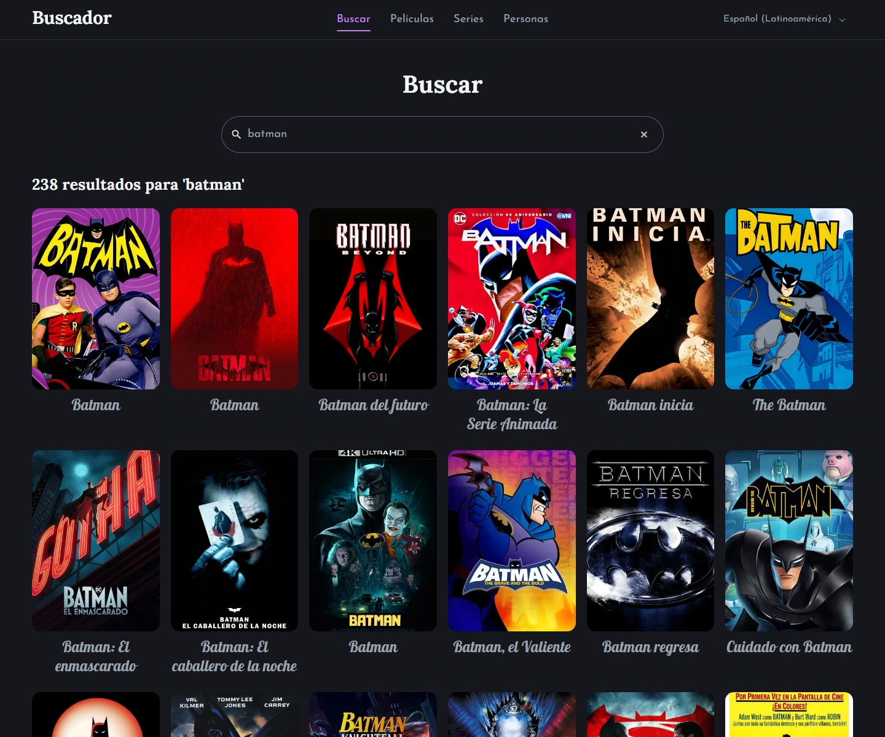
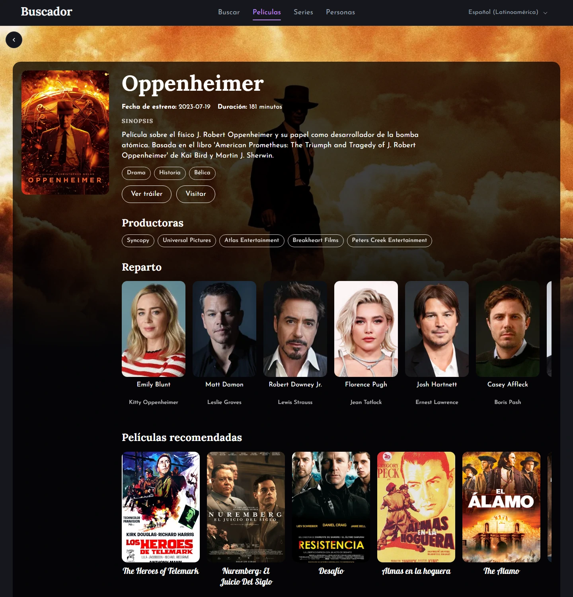
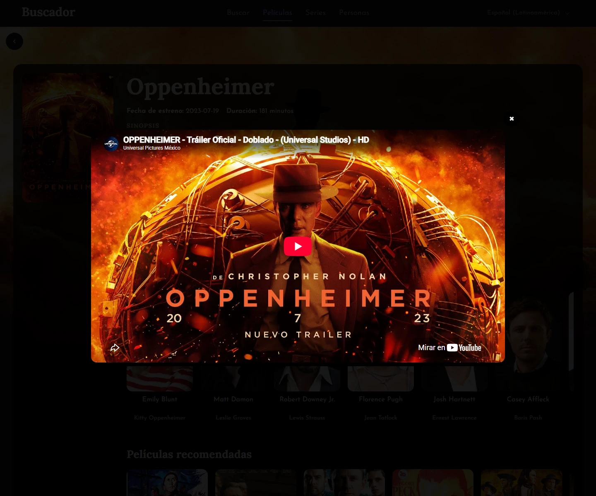
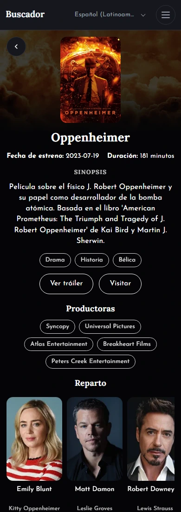

# 🎬 Buscador de Películas, Series y Personas

**Busca y explora películas, series y personas con la API de TMDB.**

<p>
  <a href="https://moviesbuscador.netlify.app/"></a>
  <a href="https://github.com/Antonio-Benavente/buscador"></a>
  
  
  
  
  
  
</p>

**[▶ Ver demo en vivo](https://moviesbuscador.netlify.app/)** · **[Código en GitHub](https://github.com/Antonio-Benavente/buscador)**

## 📸 Capturas

| Portada | Búsqueda |
| :---: | :---: |
| [](https://moviesbuscador.netlify.app/) | [](https://moviesbuscador.netlify.app/search?q=batman) |
| **Ficha de detalle** | **Tráiler en modal** |
| [](https://moviesbuscador.netlify.app/movies/872585) | [](https://moviesbuscador.netlify.app/movies/872585) |

<p align="center">
  <a href="https://moviesbuscador.netlify.app/movies/872585"></a><br>
  <sub>Ficha de detalle en móvil</sub>
</p>

## 📝 Descripción

SPA para buscar y explorar películas, series y personas usando la API de TMDB. Incluye portada con carruseles, listados paginados, fichas con reparto, tráilers y recomendaciones, búsqueda con debounce e interfaz en 9 idiomas con detección automática de región.

## ✨ Características principales

- **Búsqueda multi** de películas, series y personas, con debounce, paginación y cancelación de peticiones.
- **Portada con carruseles automáticos**: en cartelera, próximos estrenos, películas y series populares.
- **Listados paginados con pestañas**: populares, en emisión, al aire hoy y mejor valoradas.
- **Fichas completas**: sinopsis, datos, reparto, productoras, tráiler en modal y recomendaciones.
- **9 idiomas** (es-MX, es-ES, en-US, pt-BR, fr-FR, de-DE, it-IT, ja-JP y ko-KR) con carga bajo demanda.
- **Región automática o manual** (30 mercados), independiente del idioma y persistida en `localStorage`.
- **Tema claro/oscuro** según el sistema, diseño responsive y detalles de accesibilidad.
- **Caché, reintentos y skeletons**: navegación fluida incluso al volver a una vista ya visitada.
- **Manejo de errores en capas**: 404, fallos de red y errores de renderizado.

## 🎯 Qué demuestra este proyecto

- **React 19 moderno**: rutas con `lazy` + `Suspense`, hooks propios, `useSyncExternalStore`, `ErrorBoundary` y React Compiler.
- **Gestión de datos sin librerías externas**: `fetch` nativo con `AbortController`, caché en memoria, reintentos y una clave de vigencia que evita race conditions.
- **Internacionalización real**: 9 locales con carga diferida, fallback, `document.lang` y nombres de países con `Intl.DisplayNames`.
- **Accesibilidad y UX**: focus trap en el modal, copias `inert` en el carrusel, `prefers-reduced-motion`, skeletons y estados vacíos/error.
- **Ciclo completo de producto**: configuración por entorno, proxy opcional para ocultar el token, build de producción y despliegue con redirecciones SPA.

## 🛠 Tecnologías

| Área | Tecnología |
| --- | --- |
| UI | [React 19](https://react.dev/) + [React Compiler](https://react.dev/learn/react-compiler) |
| Build | [Vite 8](https://vite.dev/) |
| Routing | [React Router 7](https://reactrouter.com/) |
| i18n | [i18next 26](https://www.i18next.com/) + [react-i18next 17](https://react.i18next.com/) |
| Estilos | CSS moderno: variables, grid/flex y temas claro/oscuro |
| Datos | [TMDB API v3](https://developer.themoviedb.org/docs) (REST) |
| Calidad | [ESLint 10](https://eslint.org/) + `jsx-a11y` + `react-hooks` + `react-refresh` |
| Paquetes | [pnpm](https://pnpm.io/) |
| Despliegue | [Netlify](https://www.netlify.com/) |

## 🚀 Puesta en marcha

### Requisitos

- Node.js **20.19+** o **22.12+**
- [pnpm](https://pnpm.io/installation)
- Una cuenta de TMDB con un **API Read Access Token** (v4)

### Pasos

1. Clona el repositorio e instala las dependencias:

   ```bash
   git clone https://github.com/Antonio-Benavente/buscador.git
   cd buscador
   pnpm install
   ```

2. Crea el archivo `.env` a partir de la plantilla:

   ```bash
   # macOS / Linux
   cp .env.example .env

   # Windows (PowerShell)
   Copy-Item .env.example .env
   ```

3. Añade tu token de TMDB. Puedes obtenerlo en
   [themoviedb.org/settings/api](https://www.themoviedb.org/settings/api),
   sección *API Read Access Token*:

   ```env
   VITE_TMDB_TOKEN=tu_api_read_access_token
   ```

4. Arranca el servidor de desarrollo:

   ```bash
   pnpm dev
   ```

### Variables de entorno

| Variable | Obligatoria | Descripción |
| --- | :---: | --- |
| `VITE_TMDB_TOKEN` | Sí\* | API Read Access Token (v4) de TMDB. |
| `VITE_TMDB_PROXY_URL` | No | URL base de un proxy propio que añade el token en el servidor. Si se define, el cliente no envía el token. |

\* Si usas `VITE_TMDB_PROXY_URL`, `VITE_TMDB_TOKEN` puede quedar vacío.

### Scripts

| Comando | Descripción |
| --- | --- |
| `pnpm dev` | Servidor de desarrollo con HMR. |
| `pnpm build` | Genera la build de producción en `dist/`. |
| `pnpm preview` | Sirve localmente la build de producción. |
| `pnpm lint` | Analiza el código con ESLint. |

## 📦 Despliegue

El repositorio incluye [`netlify.toml`](netlify.toml) con el comando de build,
la carpeta `dist` y la redirección SPA para que rutas como `/movies/123`
funcionen al recargar.

1. En Netlify, elige **Add new site → Import an existing project** y conecta el repositorio.
2. Netlify detecta `pnpm-lock.yaml` y aplica la configuración de `netlify.toml`.
3. En **Site configuration → Environment variables** define `VITE_TMDB_TOKEN`
   o `VITE_TMDB_PROXY_URL`.
4. Despliega. Cada push a la rama principal genera una nueva build.

> **Producción:** Vite incrusta `VITE_TMDB_TOKEN` en el bundle del cliente. Para
> no exponerlo, define `VITE_TMDB_PROXY_URL` y delega las llamadas a TMDB en una
> función serverless o un backend ligero. En cualquier otro hosting estático,
> configura una redirección de `/*` a `/index.html`.

## 🗂 Estructura del proyecto

```text
.
├── docs/screenshots/      Capturas usadas en el README (WebP)
├── public/                Favicon e iconos estáticos
├── src/
│   ├── components/        Header, Footer, SearchBar, MediaCard, Carousel, MediaDetails...
│   ├── hooks/             useTmdb, useRequest, useMediaDetails, useTrailerModal, useRegion...
│   ├── i18n/              Configuración de i18next y carga de locales
│   ├── locales/           Traducciones de los 9 idiomas (es-MX como referencia)
│   ├── pages/             Home, Search, MediaList, fichas de detalle, 404 y error
│   ├── services/          Cliente TMDB y endpoints de películas, series y personas
│   ├── utils/             Config, constantes, imágenes, parámetros, errores y helpers
│   ├── App.jsx            Layout y definición de rutas
│   ├── main.jsx           Bootstrap, Router y ErrorBoundary
│   └── index.css          Reset, variables y tema claro/oscuro
├── .env.example           Plantilla de variables de entorno
├── netlify.toml           Build, publish y redirección SPA
├── vite.config.js         Plugins de React y React Compiler
├── eslint.config.js       Configuración plana de ESLint
└── package.json           Dependencias y scripts
```

## 🧠 Decisiones técnicas

- **La URL es la fuente de verdad** en búsqueda y paginación (`?q=` y `?page=`).
  Escribir sustituye la entrada del historial; paginar la añade, así el botón
  atrás restaura consulta y página. La paginación se limita a 500, el máximo de TMDB.
- **Una única capa de peticiones.** `useRequestState` y `useTmdb` comparten
  clave de vigencia, aborto y reintento; solo se pinta la respuesta de la
  petición actual.
- **Caché en memoria con TTL de 5 minutos** (máximo 200 entradas). Las respuestas
  abortadas no se guardan, y volver a un listado o ficha no repite peticiones.
- **Idioma y región son ejes distintos.** El idioma define los textos; la región,
  el mercado. La región se detecta por huso horario, luego por locale y por
  idioma, se puede cambiar desde el footer y solo se envía a los endpoints que
  TMDB admite.
- **Errores en capas.** `ErrorBoundary` captura fallos de render; las rutas
  inexistentes y los 404 de TMDB muestran `Page404`; los fallos de red muestran
  `ErrorState` con opción de reintentar.
- **Token fuera del bundle en producción.** El cliente envía el header `Bearer`
  solo si existe un token y soporta un proxy mediante `VITE_TMDB_PROXY_URL`.
- **UX accesible.** El carrusel duplica elementos con `inert`, el modal atrapa el
  foco y cierra con `Escape`, se respeta `prefers-reduced-motion` y las vistas
  usan skeletons para no perder el contexto durante la carga.

## 🧪 Próximos pasos

- [ ] Añadir tests con **Vitest** y Testing Library para la capa de peticiones, las utilidades y los flujos principales (búsqueda y fichas de detalle).

## 📄 Licencia y créditos TMDB

Distribuido bajo licencia **MIT**. Consulta el archivo [LICENSE](LICENSE).

Este producto utiliza la API de **[The Movie Database (TMDB)](https://www.themoviedb.org/)**,
pero **no está respaldado ni certificado por TMDB**. Los datos, pósters, imágenes
y tráilers pertenecen a sus respectivos titulares y se obtienen a través de TMDB.

- [TMDB](https://www.themoviedb.org/)
- [Documentación de la API de TMDB](https://developer.themoviedb.org/docs)

Hecho con ❤️ por [Antonio Benavente](https://github.com/Antonio-Benavente).
